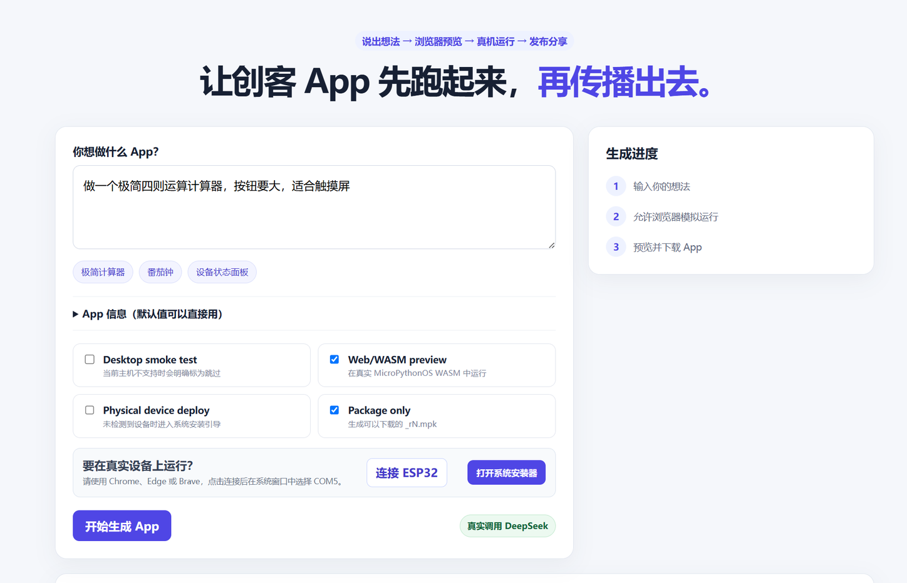
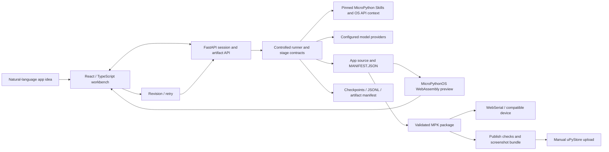
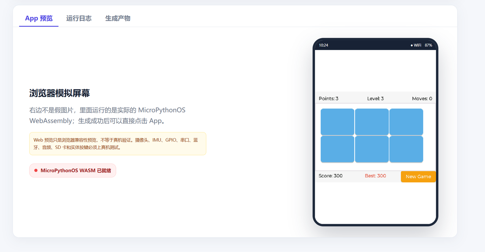
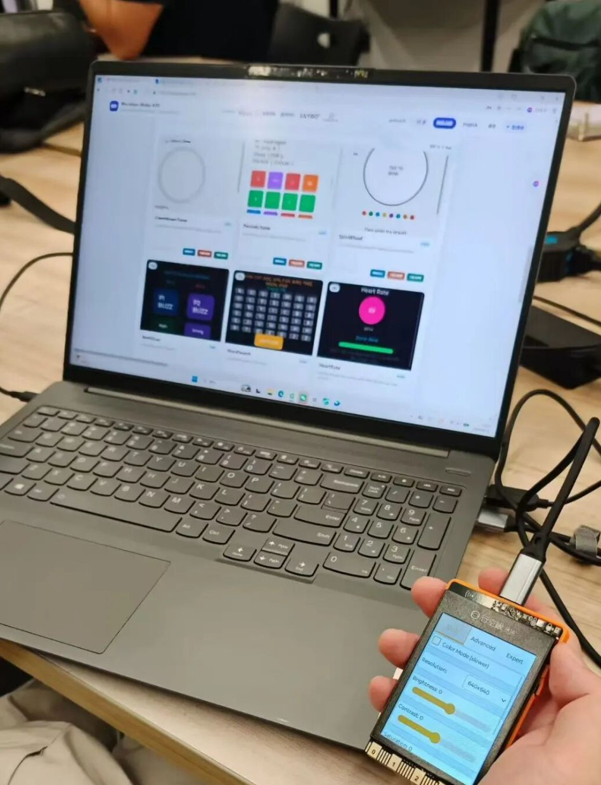
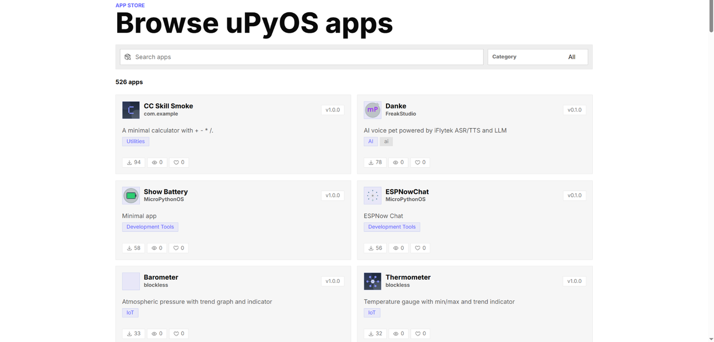

[English](README.md) | [简体中文](README.zh-CN.md)

<div align="center">

# MicroPythonOS AI App Builder

**An AI-assisted application development environment for MicroPythonOS.**

Describe an app, preview it in the browser, iterate, build an MPK, and take it to real hardware.

[](LICENSE)
[](frontend/package.json)
[](backend/requirements.txt)
[](vendor/MicroPythonOS)
[](https://upystore.io/)

</div>



*Project screenshot of the requirement and generation workbench, cropped to remove the account header. UI labels may differ between revisions.*

## Contents

[Overview](#overview) · [Features](#key-features) · [Workflow](#app-generation-workflow) · [Architecture](#system-architecture) · [Preview](#browser-preview) · [Packaging](#building-and-packaging-apps) · [Hardware](#deploying-to-hardware) · [uPyStore](#upystore-ecosystem) · [Quick start](#quick-start) · [Documentation](#documentation) · [License](#license)

## Overview

MicroPythonOS AI App Builder, also named **Blockless-Make-APP** in the source and UI, is a browser-based environment for building MicroPythonOS applications from natural language. It brings requirements, generated MicroPython/LVGL code, interactive preview, revision history, MPK packaging, device installation, and sharing preparation into one workflow.

This repository implements the **development environment**. [MicroPythonOS](https://github.com/MicroPythonOS/MicroPythonOS) is the separate operating system/runtime, pinned here as an upstream submodule. Generated apps use MicroPythonOS APIs; the builder does not replace the OS.

## Key features

| Capability | Current implementation |
| --- | --- |
| Natural-language app generation | Requirement analysis, API constraints, and MicroPython/LVGL app source generation |
| AI-assisted iteration | Revisions use the previous successful source; downloadable change patches and failure records preserve context |
| Browser live preview | A bundled WebAssembly MicroPythonOS runtime runs app logic and UI in the browser |
| App packaging | Manifest validation and real downloadable `<fullname>_rN.mpk` archives |
| Hardware deployment | Browser WebSerial installation/start workflow and recorded device results |
| App discovery and sharing | Local showcase resources and uPyStore publish checks, screenshots and upload materials |
| Developer workflow | Session APIs, SSE progress, stage results, checkpoints, activity logs and artifact manifests |
| Optional desktop checks | Smoke execution when the required Linux SDL/controller toolchain is present; otherwise explicitly skipped |

Browser preview, packaging, and real-device operation are separate results. Missing tools or a disconnected device must not be reported as passed hardware tests.

## How it works

The backend treats app creation as a recoverable long-running task. The frontend collects the requirement and displays stage progress; controlled backend services perform generation, checks, packaging, and artifact handling. Skills provide workflow contracts, and the runner maps them to supported operations.

The developer can inspect artifacts, retry a failed stage, or request a new revision. Device installation requires a browser/device connection. Publishing prepares a handoff for uPyStore rather than silently uploading an app.

## System architecture



| Directory | Responsibility |
| --- | --- |
| [`frontend/`](frontend) | Browser workbench, preview integration, artifacts, WebSerial and sharing UI |
| [`backend/`](backend) | Authentication, sessions, generation, storage, stage execution and APIs |
| [`runner/`](runner/README.md) | Stage schemas, adapter contracts and controlled execution conventions |
| [`frontend/public/mpos-web/`](frontend/public/mpos-web) | Bundled WASM runtime and preloaded upstream resources |
| [`vendor/MicroPythonOS/`](vendor/MicroPythonOS) | Pinned upstream OS/runtime source |
| [`vendor/MicroPython_Skills/`](vendor/MicroPython_Skills) | Pinned app-development workflows and API references |
| [`docs/`](docs) | Architecture, capability boundaries and development guidance |

## App generation workflow

**Natural language → AI generation → browser preview → iteration → MPK packaging → device deployment → app sharing**

| Stage | What to inspect |
| --- | --- |
| Analyze | App requirements, target capabilities, API and dependency assumptions |
| Prepare dependencies | App-local dependencies when needed; leave the OS/framework unchanged |
| Generate | MicroPython/LVGL source and app metadata |
| Test / preview | Actual runtime outcome, explicit skips, warnings, and screenshots |
| Package | Manifest validation and downloadable `.mpk` |
| Deploy | Browser connection, install/start results, and actual device behavior |
| Publish check | Screenshot gates, metadata, bundle and manual upload guidance |

Sessions record checkpoint history, `phase_complete.*.json`, stage results, `activity_log.jsonl`, and an `artifact_manifest.json`. Failed/retried attempts and successful revisions are preserved separately. Stage presence describes the workflow, not a guarantee that every run succeeds.

## Browser preview



*Captured application preview from the project materials.*

The preview uses a **WebAssembly build of MicroPythonOS** rather than a static UI mockup. It is useful for checking layouts, touch interaction, app lifecycle, and basic logic before installing an app on a board.

The browser target cannot reproduce every GPIO, sensor, BLE, camera, or board-specific peripheral. Runtime availability and rendering can also differ from the physical display and firmware. Hardware behavior needs a device run. See [cross-device capability boundaries](docs/cross-device-capability-integration.md).

## Building and packaging apps

The packaging stage validates `MANIFEST.JSON` and creates an MPK installation archive. Download it through the workbench artifact list; packages use `<fullname>_rN.mpk` so revisions remain identifiable.

Inspect the app entrypoint, metadata, declared capabilities and packaged files before installation or sharing. The app code belongs in its generated app directory; avoid changing MicroPythonOS or LVGL internals to make a generated app appear to pass.

The browser preview, a downloadable MPK, and a running app on hardware are distinct deliverables. A successful archive build does not establish device compatibility.

## Deploying to hardware



*Project-provided workshop photo showing browser development and a connected physical display device.*

Use a compatible ESP32/ESP32-S3 device with the appropriate MicroPythonOS build and hardware profile. The browser connects through WebSerial, installs the app, starts it, and sends results back to the session record.

1. Use a WebSerial-capable browser, such as Chrome or Edge, in a secure context (`localhost` for local development, HTTPS for remote access).
2. Connect the board with a data-capable USB cable and select its serial port.
3. Verify the OS/firmware and board capabilities before installation.
4. Install the generated MPK and inspect the real screen, interactions, and peripherals.

When the workflow reports `waiting_device`, generation/packaging can already be complete while the browser waits for a connection. Treat it as a device handoff state. The hardware ecosystem page is a compatibility reference; it does not mean all generated apps work unchanged on every listed board.

## uPyStore ecosystem

[uPyStore](https://upystore.io/) is an entry point for discovering, sharing, and distributing MicroPythonOS applications. The builder prepares app metadata, screenshots, validation results and a material bundle for manual upload.



*Historical catalog screenshot, cropped to remove account/admin navigation. Any count visible in the screenshot describes that capture, not a live app total.*

The repository also contains showcase resources for browsing examples. They are separate from a live marketplace inventory. Publishing checks and upload guidance do not constitute automatic publication or marketplace acceptance.

## Quick start

Use Python **3.12** and Node.js **22+** as the local development baseline, matching the container setup. Start with the pinned submodules:

```sh
git clone --recurse-submodules https://github.com/FreakStudioCN/micropythonos-ai-app-builder.git
cd micropythonos-ai-app-builder
git submodule update --init --recursive
python -m venv .venv
```

Activate `.venv` using `.venv/Scripts/Activate.ps1` on Windows PowerShell, or `source .venv/bin/activate` on Linux/macOS, then:

```sh
python -m pip install -r backend/requirements.txt -r runner/requirements.txt
```

Copy `backend/.env.example` to ignored `backend/.env`. Configure a supported model provider using your own key; the template values are placeholders. Secrets stay on the backend. Start the API from the repository root:

```sh
python -m uvicorn app.main:app --app-dir backend --host 127.0.0.1 --port 8000
```

In a second terminal:

```sh
cd frontend
npm ci
npm run dev
```

Open `http://localhost:5174/`. The health endpoint is `http://localhost:8000/api/health`. Register/sign in through the workbench, enter a small app requirement, enable the desired preview/package stages, and inspect the generated artifacts.

The frontend uses a strict `5174` port. To change the API address, copy `frontend/.env.example` to `frontend/.env.local` and set `VITE_API_BASE`. Local development has SQLite/filesystem fallback; hosted deployments need durable database and object storage configuration. See [development and deployment](docs/development.md).

## Documentation

- [Architecture and session protocol](docs/architecture.md)
- [Cross-device capability boundaries](docs/cross-device-capability-integration.md)
- [Local development, configuration and validation](docs/development.md)
- [Hosted-service credits and payment configuration](docs/payments.md)
- [Runner](runner/README.md), [adapter contract](runner/adapters/mpos/README.md), [result schemas](runner/schemas)
- [Screenshot provenance](docs/assets/readme/README.md) and [third-party notices](THIRD_PARTY_NOTICES.md)

## Contributing

Useful contributions include reproducible app examples, accurate API/capability context, runtime error reports, preview fixes, and device compatibility evidence. Include the prompt, revision, OS/submodule versions, error output, and redacted artifacts. Report preview results and hardware results separately.

Keep generated app fixes within the app layer. Use the focused checks in [development guidance](docs/development.md) for changed components. Never commit provider keys, personal serial information, user session directories, or private designs.

## Related projects

| Project | Focus |
| --- | --- |
| [MPY Hardware Extension](https://github.com/FreakStudioCN/mpy-hardware-extension) | Hardware-aware MicroPython development inside VS Code |
| [AI Agent Embedded Device Debugging Kit](https://github.com/FreakStudioCN/ai-agent-embedded-debugging-kit) | Let agents observe, operate and test real embedded devices |
| [MicroPythonOS](https://github.com/MicroPythonOS/MicroPythonOS) | Upstream operating system and runtime used by generated apps |

The three developer-tool projects are independent. These links do not imply that a complete software integration has shipped.

## License

Project-owned builder code is licensed under [MIT](LICENSE). The collective contributor attribution does not transfer individual contributors' ownership. Earlier revisions used Apache-2.0; its text is retained for historical provenance in [docs/licenses/Apache-2.0-historical.txt](docs/licenses/Apache-2.0-historical.txt).

Upstream MicroPythonOS, skills, WASM components, bundled apps, fonts, icons and third-party assets retain their original copyright and license terms. The root MIT license does not relicense them. See [THIRD_PARTY_NOTICES.md](THIRD_PARTY_NOTICES.md), including the bundled-app and runtime provenance limitations.
