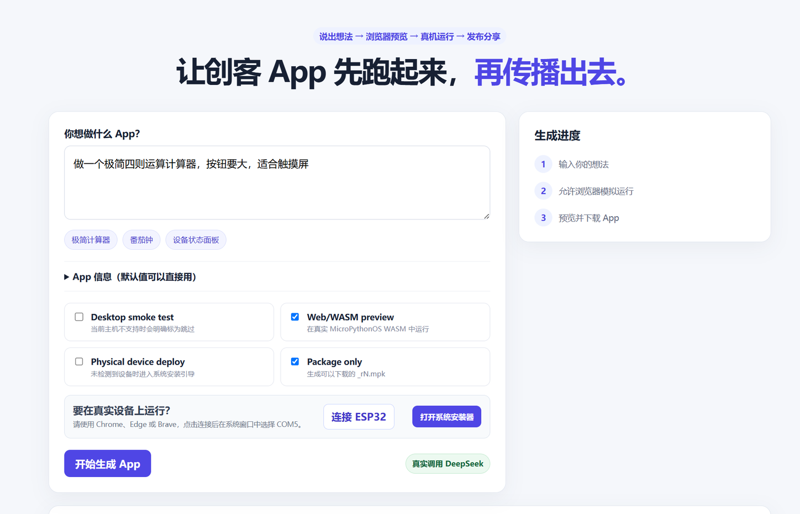
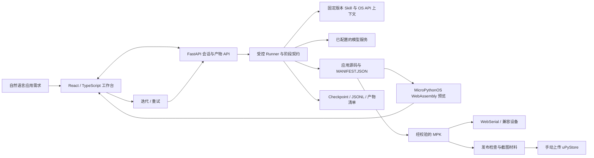
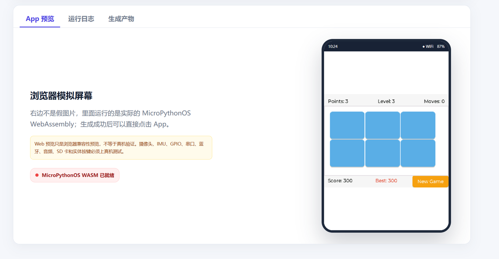
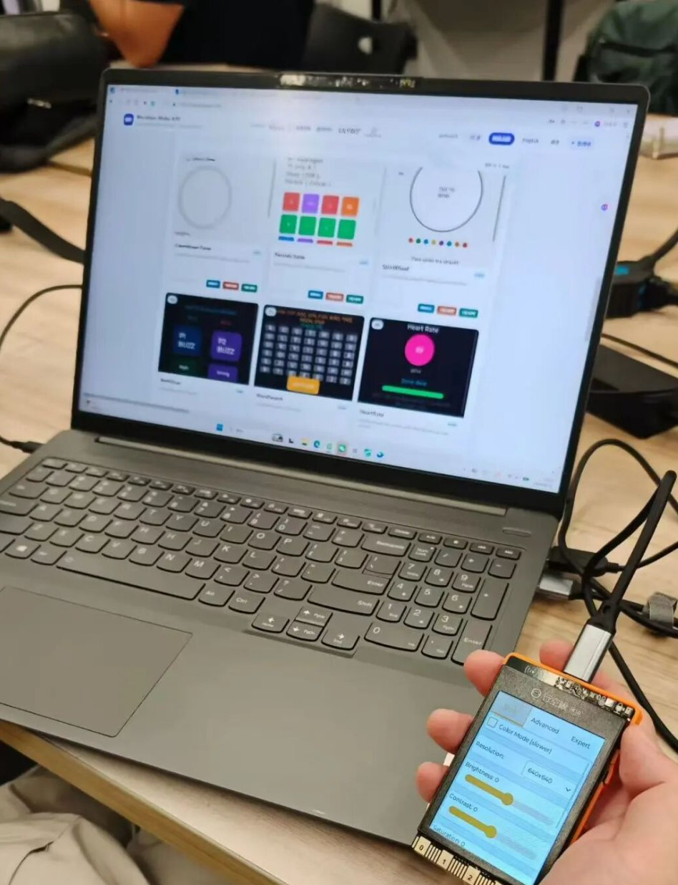
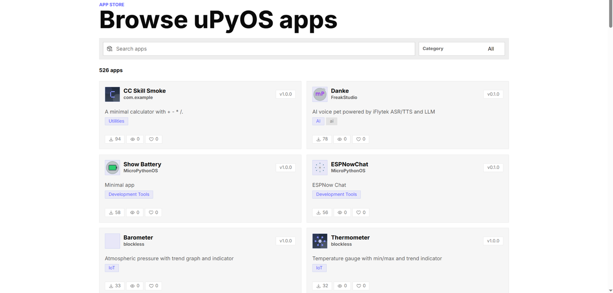

[English](README.md) | [简体中文](README.zh-CN.md)

<div align="center">

# MicroPythonOS AI App Builder

**面向 MicroPythonOS 的 AI 辅助应用开发环境。**

描述应用，在浏览器里预览和迭代，生成 MPK，再安装到真实硬件。

[](LICENSE)
[](frontend/package.json)
[](backend/requirements.txt)
[](vendor/MicroPythonOS)
[](https://upystore.io/)

</div>



*项目原始截图，展示需求和生成工作台，已裁去账号顶栏。不同版本的界面名称可能有所变化。*

## 目录

[项目概述](#项目概述) · [主要功能](#主要功能) · [生成流程](#应用生成流程) · [架构](#系统架构) · [预览](#浏览器预览) · [打包](#构建与打包) · [硬件](#部署到真实硬件) · [uPyStore](#upystore-生态) · [快速开始](#快速开始) · [文档](#技术文档) · [许可证](#许可证)

## 项目概述

MicroPythonOS AI App Builder 在代码和界面中也称为 **Blockless-Make-APP**，是通过自然语言构建 MicroPythonOS 应用的浏览器开发环境。它将需求、MicroPython/LVGL 代码、交互预览、版本迭代、MPK 打包、设备安装和分享准备连接起来。

本仓库实现的是**开发环境**。[MicroPythonOS](https://github.com/MicroPythonOS/MicroPythonOS) 是独立的操作系统和运行时，通过上游子模块固定版本接入。生成应用使用 MicroPythonOS API，App Builder 不代替操作系统。

## 主要功能

| 能力 | 当前实现 |
| --- | --- |
| 自然语言生成 | 需求分析、API 约束、MicroPython/LVGL 源码生成 |
| AI 辅助迭代 | 基于上一成功版本继续修改，提供差异补丁并保留失败记录 |
| 浏览器实时预览 | 使用内置 WebAssembly MicroPythonOS 运行应用逻辑与界面 |
| 应用打包 | 清单校验与真实可下载的 `<fullname>_rN.mpk` |
| 硬件部署 | 浏览器 WebSerial 安装/启动流程及设备结果记录 |
| 发现与分享 | 本地示例展示、uPyStore 发布检查、截图和上传材料 |
| 开发者工作流 | 会话 API、SSE 进度、阶段结果、checkpoint、活动日志与产物清单 |
| 可选桌面检查 | Linux SDL/controller 工具链齐备时执行，否则明确记录跳过 |

浏览器预览、打包和实机运行是独立结果。缺少工具或未连接设备，不能被记录成硬件验证通过。

## 工作方式

后端把应用创建视为可恢复的长任务。前端收集需求并展示阶段进度，受控后端服务执行生成、检查、打包和产物管理。Skill 提供工作流契约，Runner 将其映射到支持的操作。

开发者可以查看产物、重试失败阶段或创建新版本。设备安装需要浏览器连接实际设备。发布阶段生成 uPyStore 上传交接材料，不会静默发布应用。

## 系统架构



| 目录 | 职责 |
| --- | --- |
| [`frontend/`](frontend) | 浏览器工作台、预览、产物、WebSerial 和分享界面 |
| [`backend/`](backend) | 认证、会话、生成、存储、阶段执行与 API |
| [`runner/`](runner/README.md) | 阶段 Schema、适配契约与受控执行约定 |
| [`frontend/public/mpos-web/`](frontend/public/mpos-web) | 内置 WASM 运行时和预加载上游资源 |
| [`vendor/MicroPythonOS/`](vendor/MicroPythonOS) | 固定版本的上游操作系统源码 |
| [`vendor/MicroPython_Skills/`](vendor/MicroPython_Skills) | 固定版本应用开发工作流和 API 资料 |
| [`docs/`](docs) | 架构、能力边界和开发说明 |

## 应用生成流程

**自然语言 → AI 生成 → 浏览器预览 → 迭代 → MPK 打包 → 设备部署 → 应用分享**

| 阶段 | 应检查的内容 |
| --- | --- |
| Analyze | 应用需求、目标能力、API 和依赖假设 |
| Prepare dependencies | 按需准备应用本地依赖，不修改操作系统框架 |
| Generate | MicroPython/LVGL 源码和应用元数据 |
| Test / preview | 真实运行结果、明确的跳过、警告和截图 |
| Package | 清单验证和可下载 `.mpk` |
| Deploy | 浏览器连接、安装/启动记录和实物表现 |
| Publish check | 截图门禁、元数据、材料包和手动上传说明 |

会话保留 checkpoint 历史、`phase_complete.*.json`、阶段结果、`activity_log.jsonl` 和 `artifact_manifest.json`。失败/重试现场与成功版本分别保存。存在某个阶段不表示每次运行都会成功。

## 浏览器预览



*取自项目材料中的应用预览截图。*

预览使用 **MicroPythonOS 的 WebAssembly 构建**，可用于安装前检查布局、触摸交互、应用生命周期和基础逻辑。

浏览器不能复现全部 GPIO、传感器、BLE、摄像头或板级外设。运行时能力和显示效果也可能与实机固件、屏幕不同。硬件行为仍需设备运行验证，见[跨设备能力边界](docs/cross-device-capability-integration.md)。

## 构建与打包

打包阶段校验 `MANIFEST.JSON` 并生成 MPK 安装归档，通过工作台产物列表下载。命名为 `<fullname>_rN.mpk`，便于识别版本。

安装或分享前检查入口、元数据、能力声明和包内文件。应用代码应位于生成的应用目录，不通过修改 MicroPythonOS 或 LVGL 内部实现来迁就生成结果。

浏览器预览、可下载 MPK 和真实设备上的运行应用是三个独立交付结果。归档构建成功不代表硬件兼容性已经验证。

## 部署到真实硬件



*项目提供的工坊实拍，展示浏览器开发与连接的实体显示设备。*

使用兼容 ESP32/ESP32-S3 设备及其适配的 MicroPythonOS 固件和硬件配置。浏览器通过 WebSerial 连接、安装并启动应用，再将结果回写会话。

1. 使用支持 WebSerial 的浏览器，例如 Chrome 或 Edge；本机开发使用 `localhost`，远程访问使用 HTTPS。
2. 通过支持数据传输的 USB 线连接开发板，选择正确串口。
3. 安装前核对操作系统/固件和开发板能力。
4. 安装生成 MPK，检查实机屏幕、交互和外设表现。

`waiting_device` 表示流程正在等待浏览器连接设备，此时生成与打包可能已经完成。硬件生态页是兼容性参考，不代表所有生成应用都能不加修改地运行在每一块列出的板卡上。

## uPyStore 生态

[uPyStore](https://upystore.io/) 是 MicroPythonOS 应用的发现、分享和分发入口。App Builder 准备应用元数据、截图、验证结果和材料包，用于手动上传。



*历史目录截图，已裁去账号/管理导航。截图中可见数量仅反映拍摄时刻，不代表实时应用总数。*

仓库中的应用展示资源用于浏览示例，不能等同于在线商城实时库存。发布检查和上传指导不表示自动发布，也不代表商城已经接受应用。

## 快速开始

以 Python **3.12** 和 Node.js **22+** 作为本地开发基线，与容器配置一致。先初始化固定版本的子模块：

```sh
git clone --recurse-submodules https://github.com/FreakStudioCN/micropythonos-ai-app-builder.git
cd micropythonos-ai-app-builder
git submodule update --init --recursive
python -m venv .venv
```

Windows PowerShell 使用 `.venv/Scripts/Activate.ps1` 激活，Linux/macOS 使用 `source .venv/bin/activate`，然后安装依赖：

```sh
python -m pip install -r backend/requirements.txt -r runner/requirements.txt
```

复制 `backend/.env.example` 为被忽略的 `backend/.env`，配置受支持的模型服务和自己的 key；模板值只是占位符，密钥只放后端。在根目录启动 API：

```sh
python -m uvicorn app.main:app --app-dir backend --host 127.0.0.1 --port 8000
```

第二个终端运行：

```sh
cd frontend
npm ci
npm run dev
```

访问 `http://localhost:5174/`，健康检查地址为 `http://localhost:8000/api/health`。在工作台注册/登录，输入小型应用需求，选择需要的预览/打包阶段并检查产物。

前端严格使用 `5174` 端口。需要修改 API 地址时，复制 `frontend/.env.example` 为 `frontend/.env.local` 并设置 `VITE_API_BASE`。本地可使用 SQLite/文件系统回退；托管部署需要持久数据库和对象存储，见[开发与部署说明](docs/development.md)。

## 技术文档

- [架构与会话协议](docs/architecture.md)
- [跨设备能力边界](docs/cross-device-capability-integration.md)
- [本地开发、配置与检查](docs/development.md)
- [托管服务点数与支付配置](docs/payments.md)
- [Runner](runner/README.md)、[适配契约](runner/adapters/mpos/README.md)、[结果 Schema](runner/schemas)
- [图片来源](docs/assets/readme/README.md)与[第三方声明](THIRD_PARTY_NOTICES.md)

## 参与贡献

欢迎提供可复现应用示例、准确 API/能力上下文、运行时错误报告、预览修复和实机兼容性证据。问题报告包括提示词、版本、OS/子模块版本、错误输出和脱敏产物，并区分预览结果与实机结果。

生成应用的修复保持在应用层。按[开发说明](docs/development.md)对修改组件进行必要检查，不提交模型密钥、个人串口信息、用户会话目录或私有设计。

## 相关项目

| 项目 | 方向 |
| --- | --- |
| [MPY Hardware Extension](https://github.com/FreakStudioCN/mpy-hardware-extension) | VS Code 中理解硬件的 MicroPython 开发 |
| [AI Agent Embedded Device Debugging Kit](https://github.com/FreakStudioCN/ai-agent-embedded-debugging-kit) | Agent 观察、操作和测试真实嵌入式设备 |
| [MicroPythonOS](https://github.com/MicroPythonOS/MicroPythonOS) | 生成应用所使用的上游操作系统和运行时 |

三个开发工具项目独立维护，这些链接不表示完整软件集成已经交付。

## 许可证

项目自有 App Builder 代码采用 [MIT](LICENSE)，贡献者集合署名不转移各贡献者自身的权利。早期版本使用 Apache-2.0，原文保留在 [docs/licenses/Apache-2.0-historical.txt](docs/licenses/Apache-2.0-historical.txt) 用于历史溯源。

上游 MicroPythonOS、Skill、WASM 组件、预置应用、字体、图标和第三方素材保留原版权与许可证，根目录 MIT 不对其重新授权。具体范围和预置应用/运行时来源限制见 [THIRD_PARTY_NOTICES.md](THIRD_PARTY_NOTICES.md)。
